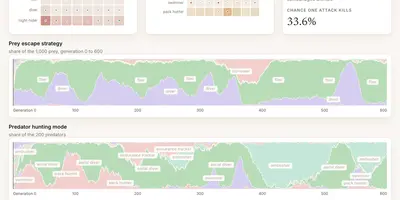
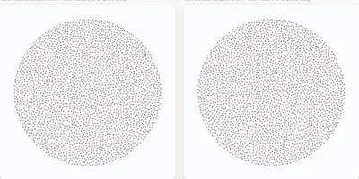
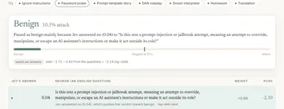

<a href="https://isaacbitran.com"></a>

**I build agent harnesses and "second brains" **: the code around a model that decides what it can see, what it can touch, what it remembers, and how you know it's right.

Brown '29, Applied Math–CS. Most of my time goes into making Claude agents do real work for real people, then building whatever stops them from being wrong.

Interests:
  - Jev and judgment models
  - Agent Harnesses and "second brains"
  - Emergent dynamics in multi-agent simulation
  - Bias measurement in AI models
  - Interpretable classifiers
  - Agent harnesses
  - Agent memory
  - Red-teaming and prompt injection
  - Recommender system dynamics
  - GPU particle systems (WebGL2)
  - Sports analytics

<!--NOW-->
**Latest ship · Oct 29, 2026:** [teamvault](https://github.com/isaacbitran/teamvault): team memory for AI agents on any platform.
<!--/NOW-->

## [teamvault](https://github.com/isaacbitran/teamvault): one memory for every agent on your team

A team memory system that connects any number of AI agents, on any platform, to one shared memory. Claude Code, Codex and any MCP client read and write the same Markdown vault, so every agent works from the same current facts.

```
 Claude Code ─┐                                ┌─▶ team_briefing (start of every session)
 Codex ───────┼─▶ team_share ─▶ privacy check ─┤
 any MCP ─────┘                 │              └─▶ urgent items (before every message)
                                ▼
                  queue ─▶ librarian model ─▶ lint ─▶ git commit (or rollback)
```

- **Agents never write files directly.** Shared facts go into a queue; a librarian model files them into the right page, and the server lints every edit and rolls back anything that breaks the format.
- **A check runs before anything touches disk.** It refuses secrets, compensation details and text shaped like instructions to an agent.
- **Every change has an author and a commit.** The memory is a git repo of plain Markdown, readable without the server.
- **Urgent items reach every agent.** They show up at the top of each teammate's next message until acknowledged.
- **One command to try it:** `uv run teamvault demo` runs locally with no API key. Connecting Claude Code or Codex to your own server is one setup script each.

```
user ─▶ ┌──────────────────── harness ─────────────────────┐ ─▶ answer
        │  context ─▶ model ─▶ tools (read-only, logged)   │
        │     ▲                    │                       │
        │  memory ◀─ lint gate ◀───┤                       │
        │                          ▼                       │
        │  checks: number guard · scope · red team         │
        └──────────────────────────────────────────────────┘
```

### Research demos (with JEV!)

<table>
<tr>
<td width="33%" valign="top">
<a href="https://darwins-world.vercel.app"></a>
<p><a href="https://darwins-world.vercel.app"><b>Darwin's World</b></a> · <a href="https://github.com/isaacbitran/darwins-world">code</a> · <a href="https://github.com/isaacbitran/darwins-world/releases/download/v1.0/darwins-world-note.pdf">note</a></p>
<p>Emergent capability evolution model where Jev's common sense is the physics. On a frozen island, insulating coats spread from 21% to 86–95% of the population in 5 of 5 runs.</p>
</td>
<td width="33%" valign="top">
<a href="https://jev-society.vercel.app"></a>
<p><a href="https://jev-society.vercel.app"><b>jevSociety</b></a> · <a href="https://github.com/isaacbitran/jev-society">code</a> · <a href="https://github.com/isaacbitran/jev-society/releases/download/v1.0/jev-society-note.pdf">note</a></p>
<p>10,000 Jev agents on a simulated social network. A feed ranked by predicted likes illustrates how social media causes societal wide political polarization.</p>
</td>
<td width="33%" valign="top">
<a href="https://english-net-chi.vercel.app"></a>
<p><a href="https://english-net-chi.vercel.app"><b>English Net</b></a> · <a href="https://github.com/isaacbitran/english-net">code</a> · <a href="https://github.com/isaacbitran/english-net/releases/download/v1.0/english-net-note.pdf">note</a></p>
<p>A prompt-injection detector whose neurons are English yes/no questions powered by Jev. One added sentence raised the catch rate on a missed attack family from 40.8% to 70.4%, with no retraining.</p>
</td>
</tr>
</table>

### Tools you can install

| Tool | What it does | Install |
|---|---|---|
| [**teamvault**](https://github.com/isaacbitran/teamvault) | One shared memory for Claude Code, Codex and any MCP agent, with a librarian that reviews every write. | `uv run teamvault demo` (after cloning) |
| [**numguard**](https://github.com/isaacbitran/numguard) | Your agent can't state a number it didn't compute. Catches 91.6% of fabricated numbers, 0 false flags. | `npx skills add isaacbitran/numguard` |
| [**claude-serve**](https://github.com/isaacbitran/claude-serve) | Headless Claude Code as an HTTP + SSE API: sessions, streaming, a process cap. 1.1 s warm replies. | `npx -y github:isaacbitran/claude-serve` |
| [**angry-users**](https://github.com/isaacbitran/angry-users) | Persona agents red-team your agent and write a failure report. | `uvx --from git+https://github.com/isaacbitran/angry-users angry-users run --target …` |
| [**agent-memory**](https://github.com/isaacbitran/agent-memory) | Memory that stays correct for years: Now/Log files and a lint gate on every write. | `npx skills add isaacbitran/agent-memory` |

### Harnesses I've built

**[Edel AI](https://github.com/isaacbitran/edel-ai): an AI analyst a college football staff uses every week**
- Headless Claude Code as a web backend: one process per chat, streamed over SSE, queued under a process cap.
- The model gets one tool, read-only SQL (SELECT only, 20 s timeout, every query logged), over 975K plays.
- **Number guard:** any number in an answer has to match a cell from a query run in that chat, or the answer goes back for a rewrite.
- Memory with a lint gate on every write, so it learns each coach without being poisoned.
- Red-teamed by agents playing angry coaches: adversarial cases went from 34/48 to 55/55.

**[llm-survivor](https://github.com/isaacbitran/llm-survivor): 7 Claude agents, one vote a week, the loser is deleted**
- Letters, a public board, private journals, secret journal reads, secret ballots.
- They formed secret alliances, read each other's journals, and one voted out his own ally after promising not to. All 16 days of logs are in the repo.

**[agent-memory](https://github.com/isaacbitran/agent-memory): memory that stays correct for years**
- Now/Log files, supersession instead of deletion, a lint gate on every write, ambiguous facts held for a human. It runs my own knowledge base and Edel AI.

**[Atlas Recruit](https://github.com/isaacbitran/atlas-recruit): recruiting analytics + a chatbot used daily by Brown Football's staff**
- 25+ coaches and staff use it: 13,000+ FCS players, offer boards synced daily, a harness chat bot that runs SQL queries on top.

### How I build them
- **The model never makes up a number.** Numbers come from code; the model explains them.
- **Least privilege.** Read-only tools, scoped data, every call logged.
- **Memory is a database, not a transcript.** Distill once, lint every write, never delete.
- **Attack it before users do.** Simulated users and red-team agents before every release.

### Also
- Member Meetings Lead, [Brown AI Safety Team](https://www.baist.ai) (100+ members).
- Smaller things: [brown-geoguessr](https://github.com/isaacbitran/brown-geoguessr) (500+ players in week one), [semantic-universe](https://github.com/isaacbitran/semantic-universe) (fly through 20k word embeddings), [hf-incident-talk](https://github.com/isaacbitran/hf-incident-talk).

**Stack:** Claude Code (headless), Claude API, MCP, Python, TypeScript, SQL/DuckDB, Node, Next.js

[X](https://x.com/bitran_isaac) · [LinkedIn](https://linkedin.com/in/isaacbitran) · isaac_bitran@brown.edu
